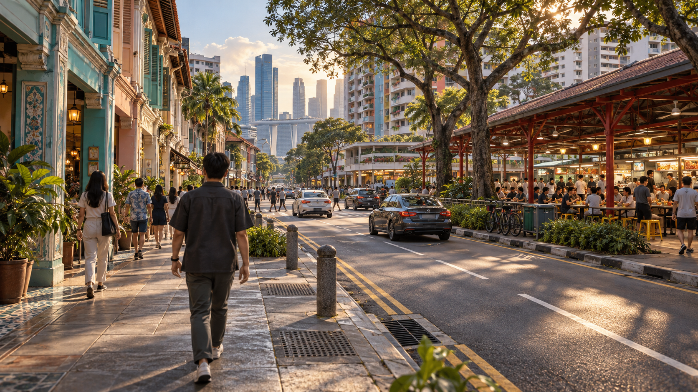

# END GOAL — The Singapore Open-World Slice

**Canonical north star for every builder, reviewer, and handoff.**

**Status:** fixed quality specification; implementation and acceptance belong in the evidence ledger. **Owner update, 2026-10-21:** the visual target is GTA VI-level fidelity in Singapore. Builders choose technical approaches autonomously; the Codex manager monitors hourly and hands the project to the next builder at each fixed four-hour boundary. The first wave is active. This document is not evidence that the target has been achieved.

## Navigation

- [1. The promise](#1-the-promise)
- [2. Player experience and bounded world](#2-player-experience-and-bounded-world)
- [3. Visual identity: grounded, coherent, genuinely 3D](#3-visual-identity-grounded-coherent-genuinely-3d)
- [4. Player movement, camera, and interaction](#4-player-movement-camera-and-interaction)
- [5. Firearms, damage, and combat feedback](#5-firearms-damage-and-combat-feedback)
- [6. Civilians, combatants, and the populated city](#6-civilians-combatants-and-the-populated-city)
- [7. Cars, theft, driving, and left-hand traffic](#7-cars-theft-driving-and-left-hand-traffic)
- [8. Helicopter: board, fly, land, exit](#8-helicopter-board-fly-land-exit)
- [9. Police and consequences](#9-police-and-consequences)
- [10. One authored mission proving the whole game](#10-one-authored-mission-proving-the-whole-game)
- [11. Interface, audio, accessibility, and persistence](#11-interface-audio-accessibility-and-persistence)
- [12. System contracts: integration is itself a requirement](#12-system-contracts-integration-is-itself-a-requirement)
- [13. Engine, asset production, and reproducibility](#13-engine-asset-production-and-reproducibility)
- [14. Performance, stability, and technical quality](#14-performance-stability-and-technical-quality)
- [15. Acceptance: evidence and independent criticism](#15-acceptance-evidence-and-independent-criticism)
- [16. Five builders, one destination](#16-five-builders-one-destination)
- [17. Boundaries and optional growth](#17-boundaries-and-optional-growth)

## 1. The promise

Build an **original, high-quality, fully playable third-person open-world action slice set in a compact, unmistakably Singapore-inspired district**. A player must walk and run through a convincing three-dimensional city, interact with its population, use firearms against fictional adult NPCs, steal and drive cars through left-hand traffic, provoke and escape police, board and fly a helicopter, land, exit, and continue playing. These are interconnected systems in the same world, not isolated demonstrations selected from a menu.

“GTA VI-quality in Singapore” is the visual north star; GTA-style gameplay describes open-world freedom, third-person action, vehicles, cinematic presentation, and systemic consequences. It does not authorize Rockstar code, assets, characters, maps, UI, audio, branding, or missions. The game must have its own identity. It is **not Manhattan with different signs**, a full-country recreation, a photogrammetry flythrough, attractive stills, or a technical demo marketed as a finished game.

The signature experience changes scale without breaking immersion: **walk under a shophouse arcade → interact with a living street → cause an incident → take a car → drive through the district → face pursuit → reach a helicopter → fly over streets just visited → land somewhere meaningful → return to walking**. Buildings and vehicles that look substantial from the air must hold up at street level.

### 1.1 Requirement language and authority

- **Required:** each numbered requirement unless explicitly labeled otherwise. Required capabilities remain requirements if time expires.
- **Provisional baseline:** a proposed measurement or content budget to calibrate against the actual map, engine, hardware, and evidence before locking implementation. Calibration may adjust a number; it may not remove the underlying experience or disguise a failure. Counts, dimensions, timings, and performance numbers in this document are proposed design targets, not claims the user independently specified those exact values.
- **Implementation choice:** builders choose the technique and engine-specific architecture while preserving the observable result.
- **Stretch:** optional work that cannot displace a required capability.
- **Pass:** supported by observations of the identified candidate build, not code existing, a builder's confidence, or an edited trailer.

**GOV-01 — Fixed destination.** This document outranks a wave goal, backlog, convenience decision, or agent vote. Agents may propose changes; only explicit user approval changes the north star. Record approved changes and reasons. Never quietly downgrade helicopter flight to a cutscene, populated streets to empty scenery, or modeled environments to flat stand-ins.

**GOV-02 — Honest experiment.** Five proposed four-hour waves are a **20-hour experiment budget, not a guarantee of the full quality bar**. Report partial completion plainly. A deadline stops authorized implementation work; it does not convert missing requirements into passes. Distinguish “best available experimental build” from “north-star accepted.”

**GOV-03 — Original fictional sandbox.** Violence and pursuit are fictional gameplay involving fictional adults and organizations. Do not model real people as targets or present the simulation as real-world tactical instruction. Use original vehicles, businesses, factions, dialogue, and missions. Singapore supplies urban inspiration, not a claim that the fiction represents its residents or institutions. Ethnicity, religion, or nationality must not determine criminal behavior.

### 1.2 Calibration authority and the frozen target

The active builder may **measure and propose** numerical calibration; an independent reviewer checks the evidence, and the active builder documents and locks the initial platform/hardware/quality/content contract under the owner’s 2026-10-21 delegation. Until then, numerical baselines remain proposals, not new promises attributed to the user. The locked contract records final values, rationale, reviewer, and date. Later changes to it need explicit approval, not a quiet edit after a failing test. No calibration may remove walking, shooting real game NPCs, car theft/driving, living traffic/population, helicopter boarding/flight/landing/exit, consequences, mission integration, 3D world quality, or honest verification. Interior room counts may be consolidated at this stage while retaining the required safe-room, shop, workshop/service, and mission-space functions and a meaningful furnished accessible subset; the whole city never becomes mandatory interior space.

### 1.3 Owner execution update — 2026-10-21

The owner delegates routine technical, engine/version, implementation and initial platform/quality-contract decisions to the active builder and relay manager. Document decisions; do not stop for a separate readiness or engine approval. This supersedes the initial-approval gate in §1.2 and older relay documents for this run. Preserve all required capabilities and the highest-quality target. Each wave has four wall-clock hours, with its final 30 minutes included for tests and handoff. The manager checks hourly, enforces the deadline and automatically starts the successor from the pushed checkpoint and `NEXT_GOAL.md`. An unfinished quality target carries forward; it never extends the clock or becomes a pass. The owner is offline; route actionable questions to the manager and continue independent work.

## 2. Player experience and bounded world

The player arrives in a believable district, not a giant empty level. There is an immediate invitation: a shaded sidewalk, a busy junction, a food-court glow, residential mass behind broad-canopy trees, and a waterfront reveal a short drive away. The first minute teaches movement and interaction without a wall of instructions. Within the opening few minutes, a new player should understand the city, find a vehicle, and create a memorable unscripted incident.

Free roam remains available before and after the mission. The mission proves integration; it is not the only place where mechanics work. Ignoring it must still reveal pedestrians, traffic, consequences, accessible cars, a reachable helicopter, and recoverable failures.

**WORLD-01 — A district, not an entire nation.** Build one contiguous authored district. A provisional high-detail core is approximately **750 × 650 m (~0.49 km²)**; calibrate dimensions against travel times and production capacity. An approximately **1.6 × 1.6 km aerial envelope (~2.56 km²)** is an initial buffer proposal, not another fully simulated city. Do not inflate playable area with inaccessible empty terrain. Document accessible ground, flyable space, and background scenery separately.

**WORLD-02 — Distinct connected precincts.** Include four recognizable spatial identities plus a functional aviation location:

1. **Heritage/shophouse street:** contiguous narrow-frontage two-/three-storey rhythms, pitched roofs, recessed thresholds, shutters, awnings, sheltered five-foot-way-inspired arcades, and rear service lanes. Supports close walking and slower vehicle movement.
2. **Public-housing-inspired neighborhood:** tall residential blocks, ground-level void-deck-inspired communal space, lift/stair entrances, sheltered links, a planted courtyard, and a carpark/service area. It must not read as anonymous Manhattan offices. A driveable multi-level carpark is a proposed content target, not a prerequisite for adding endless parking floors.
3. **Hawker/market hub:** roofed open-sided shared dining, modeled stalls, counters, tables, stools, fans, lights, tray return, bins, food-display props, and delivery access. It is a usable everyday space with sitting/queueing activity, not a theme-park mural or simply a row of shops.
4. **Modern waterfront/commercial edge:** contemporary towers, promenade or canal edge, bridge/crossing, a more open road, and a skyline viewpoint. Low-rise streets should reveal the taller skyline across water.
5. **Fictional aviation/service compound:** connected to the road network, accessible on foot, with plausible boarding space and a usable landing pad.

**WORLD-03 — Recognition through urban form.** The setting must read without a title card through several independent cues: shophouse massing/arcades, public-housing/void-deck language, hawker layout, broad-canopy tropical planting, sheltered pedestrian infrastructure, left-hand road design, and waterfront skyline. Add block numbers, drains, kerbs, service doors, condensers, transit-inspired entrances, bus shelters, and local road vocabulary purposefully. Use English-first useful signage and context-appropriate reviewed translations, never decorative generated gibberish. No copied landmark is required to carry the setting.

**WORLD-04 — Useful connected networks.** Target three connected driving loops, alternative routes between major destinations, several intersections, rear lanes, sidewalks, crossings, and pedestrian shortcuts. Test actual driving times and camera visibility. Main roads accommodate traffic; tighter streets slow it intentionally. Aerial views show the same physical layout, not a separate background map.

**WORLD-05 — Authored interiors, honest exteriors.** The proposed interior set is four finished playable spaces: safe-room, convenience/shop space, garage/workshop, and mission/service room. The open-sided hawker hall is additional public space, not a substitute for all enclosed interiors. Provide furnished rooms, ceilings, wall backs, thresholds, working entrances, camera clearance, collision, and lighting transitions. At least one genuine elevated playable area connects by stairs/ramp. Other buildings may be nonenterable, fully modeled exterior envelopes: complete roofs, sides, scale, and collision where needed. The requirement is not every apartment enterable. Unavailable doors must not promise interaction.

**WORLD-06 — Understandable boundaries.** Use water, geography, construction, fences, service gates, or clearly communicated aerial limits. Prevent walking through the map edge or flying into untextured void. Recovery returns the player/current vehicle to a safe state without corrupting objectives. Simplified background structures must not masquerade as finished reachable streets.

**WORLD-07 — Living density.** Calibrate spawn/simulation budgets using actual profiling. Provisional busiest-view targets are **24–40 nearby pedestrians and 8–12 active traffic vehicles**, plus parked vehicles; residential pockets are quieter. The outcome is inhabited streets along the playable route, not actors concentrated in one screenshot corner. Avoid visible close spawning, identical crowd clumps, and repeated camera-turn despawns.

### 2.1 Reference anchors, not licensed asset sources

Use these primary references to understand form and life; they do not grant permission to copy photographs, murals, logos, models, or branded architecture:

- [URA: understanding the shophouse](https://www.ura.gov.sg/conservation/conservation-resources/understanding-the-shophouse/) — contiguous two-/three-storey form, five-foot ways, columns, shutters, and tiled roofs.
- [URA: Tiong Bahru](https://www.ura.gov.sg/conservation/find-a-building/conservation-portal/tnbhr/) — a distinct low-rise, Streamline Moderne/Art Deco reference, not a mandate to reproduce the actual district.
- [UNESCO: hawker culture in Singapore](https://ich.unesco.org/en/RL/hawker-culture-in-singapore-community-dining-and-multicultural-urban-living-01568) and [NHB: hawker culture](https://www.nhb.gov.sg/what-we-do/our-work/sector-development/unesco/hawker-culture-in-singapore/about-hawker-culture-in-singapore) — everyday shared dining and multicultural social context.
- [NParks: our streetside companions](https://www.nparks.gov.sg/publications-resources/articles/our-streetside-companions/) — Rain Tree, Angsana, Tembusu, and Sea Almond vocabulary rather than generic palms everywhere.

## 3. Visual identity: grounded, coherent, genuinely 3D

**ART-01 — GTA VI-level fidelity, Singapore identity.** Aim for a one-to-one match in perceived visual fidelity, physical detail, material quality, believable human/vehicle scale, lighting, animation and world coherence with the official GTA VI reference imagery below, translated into Singapore. Photoreal, highest-quality contemporary real-time 3D is the target. Simplified stylization, flat-color primitive scenery, low-poly stand-ins and a generic city are not acceptable final substitutes. This is an aspirational quality target, not a claim of achieved parity or a promise that twenty hours can achieve it. Before mass production, establish a look-development sheet covering palette, human/vehicle scale, material response, exposure, lighting, asset detail tiers, and camera treatment. All builders inherit it.

**ART-02 — Model the world.** Buildings, streets, characters, cars, helicopter, guns, doors, stairs, railings, trees, furniture, and major/interactive props require actual world-space 3D meshes, with rigs where appropriate, depth, silhouette, shading, and suitable collision. Reject final billboard people/cars/buildings/trees, screenshot backdrops replacing traversable space, and primitive hero assets. Textures, trim sheets, normals, decals, leaf cards within dimensional vegetation, particles, sky imagery, and UI are legitimate surface/effect tools—not replacements for whole gameplay objects. “3D throughout” does not mean every leaf or painted letter must be modeled individually.

**ART-03 — Architecture survives close inspection.** Model parallax/shadow-defining forms: arcades, pitched roof edges, awnings, balconies, recesses, columns, steps, and kerbs. Use approximately six to eight modular architectural kits as a provisional efficiency target rather than hundreds of unrelated hero buildings. Vary modules through plausible color, use, signage, wear, and service fixtures. Leave clear human circulation; random clutter is not urban richness. Roofs and backsides seen from aircraft must be complete.

**ART-04 — Material integrity.** Keep concrete, asphalt, glass, metal, fabric, foliage, and skin distinguishable under one lighting setup. Fix stretched UVs, wrong texture scale, missing maps, metallic concrete, mirror roads, emissive skin, and excessive baked highlights. Suggested palette: warm off-white plaster, muted pastel frontage, red-brown tile, pale concrete, dark asphalt, deep green, cool glass, warm shop lighting. If wetness is used, vary it coherently; do not make every surface uniformly shiny.

**ART-05 — Characters and animations.** Deliver an original visible player and enough civilian/police variants to avoid a cloned crowd. Cover idle, walk, run, turning, aim, fire, reload, damage reaction, incapacitation, vehicle entry/exit, seated driving, helicopter boarding/seating, and NPC panic/combat. Rig/animation blending must avoid persistent foot sliding, T-poses, detached hands, floating weapons, and pelvis/seat mismatches. Film-quality capture is not required; clear coherent motion is.

**ART-06 — Functional vehicle assets.** Cars need separate rotating/steering wheels, windows, lights, doors, occupants, and a credible right-hand-drive cabin with seats and dashboard forms. The helicopter needs modeled fuselage, cabin/cockpit, pilot seat, rotor assembly, main/tail rotor animation, skids or landing gear, and readable boarding access. They are not decorative meshes with unexplained invisible control boxes. Simplified physics colliders are appropriate when reliable.

**ART-07 — Light, shade, and atmosphere.** Polish one primary time-of-day preset; warm dry late-afternoon is the suggested baseline. Rainy blue hour is a look-development alternative or stretch addition, not a mandatory full weather system. Exposures must preserve readable interiors and streets; avoid blackouts and washed-out transitions. Contact shadows, ambient depth, restrained haze, and useful tree shade should connect foreground and skyline. Avoid neon everywhere and excessive bloom hiding poor assets.

**ART-08 — No final placeholders.** Grayboxes, mannequins, debug labels, missing materials, close-range flat stand-ins, temporary audio, and untextured primitives may appear in development, but must be tracked and replaced before acceptance. Review side streets, interiors, rooftops, and reverse angles—not only the recording route. Closed modeled buildings are legitimate scope; roofless single-plane cardboard visible from the air is not.

### 3.1 Generated concepts of OUR game — primary visual targets

**Owner clarification, 2026-10-21:** reference images must show what this original game should look like in Singapore. The following three images were generated specifically for this project with the built-in image-generation tool. They are the primary working art-direction targets. Existing GTA VI screenshots and Singapore photos in §3.2 are secondary source comparisons, not substitutes for these concepts.

**These are AI-generated concept images, not captures of the current game, not proof of implementation, and not evidence of achievable frame rates.** Match their composition, modeled detail, light, material language, populated streets and Singapore identity in actual playable builds. Keep the required mechanics and bounded map scope. Do not turn implied distant scenery into a new obligation to build an entire city. Generated signs, brands, traffic details and small geometrical artifacts are not production specifications; implementation still uses original assets/signage, correct left-hand traffic, robust collision and coherent vehicle anatomy.

#### CONCEPT-01 — On-foot street and hawker hub

Primary comparison: a human-scale third-person route, modeled shophouse arcades on one side, an inhabited hawker hall on the other, detailed kerbs/drains, broad rain trees, residential blocks and distant waterfront towers. Match the warm light, dimensional surfaces, depth and density without obstructing player movement.

#### CONCEPT-02 — Driving through the same district

Primary comparison: a detailed player-controlled sedan in a plausible chase-camera view, left-hand traffic, street life, canal railings, a bridge and consistent building/material vocabulary. Vehicle cabin, wheels, paint, lights and road interaction must survive close play; a still image cannot certify controls or physics.

#### CONCEPT-03 — Helicopter flight above the connected world

Primary comparison: a recognizable modeled helicopter over the same shophouse/hawker/HDB-inspired district, complete roofs and back walls, connected roads and waterways, a visible landing pad, and coherent skyline layering. Landing and returning to on-foot play remain required.

**Generation record:** [exact prompts and method](docs/concepts/prompts.json). All three use a shared late-afternoon palette and the on-foot concept as the supporting visual reference for the driving/flight images. Their generated geometry is art direction, not an exact map blueprint. Critics compare current build captures at these three gameplay-camera scales and carry visible mismatches into the next wave. Do not claim a one-to-one fidelity match from a successful build or a textual verdict.

### 3.2 Secondary source references — fidelity and location evidence

**Owner direction: “GTA 6, but in Singapore. Highest quality possible, one-to-one remake.”** The quality-match target is explicit: pursue the fidelity of the GTA VI images while building the original Singapore setting and connected experience specified here. The reference images are source material, **not screenshots of this project**. The bounded district and required gameplay remain the scope; do not silently expand to the full content or geography of GTA VI.

Compare the candidate's actual rendered pixels with these references at similar scale, camera height and lighting. GTA VI screenshots establish rendering quality; Singapore photos establish the place. Neither replaces gameplay tests. A critic must view the images, identify the largest visible gap and send it back to the builder. A blocked image is NOT TESTED; use its source link rather than inventing what it shows. Record reference IDs in critique and handoff.

#### VI-01 — GTA VI — city depth and connected streets

Layered buildings, completed roofs, planted streets, traffic, readable balconies and distant skyline. Match that density and material depth using Singapore forms.

Source: [Rockstar Games, Vice City 03](https://www.rockstargames.com/VI/media/screenshots) · [Open full reference](https://www.rockstargames.com/VI/_next/static/media/Vice_City_03.0nqz~lrqdmlze.jpg).

#### VI-02 — GTA VI — light, vegetation and material separation

Warm directional light, varied vegetation, contact shadow, water and metal response, and coherent near-to-far detail. Judge equivalent lighting conditions rather than hiding unfinished work in darkness.

Source: [Rockstar Games, Vice City 02](https://www.rockstargames.com/VI/media/screenshots) · [Open full reference](https://www.rockstargames.com/VI/_next/static/media/Vice_City_02.0c5.7qx17u9kl.jpg).

#### VI-03 — GTA VI — close character fidelity

Skin, hair, fabric, jewelry and expressive dimensional faces establish the close-view fidelity bar. Create original people; inspect our characters at comparable screen size.

Source: [Rockstar Games, Vice City 04](https://www.rockstargames.com/VI/media/screenshots) · [Open full reference](https://www.rockstargames.com/VI/_next/static/media/Vice_City_04.06evqutgh7624.jpg).

#### SG-01 — Singapore — Joo Chiat street-level architecture

Narrow frontage rhythm, shutters, tiled roof ridges, relief ornament, deep entrances, gates, kerbs and everyday street fixtures. These need modeled depth and consistent human scale.

Source: [SG101, Joo Chiat](https://www.sg101.gov.sg/resources/archives/ourneighbourhood-joo-chiat/) · [Open full reference](https://isomer-user-content.by.gov.sg/149/722d5877-6ddb-4c63-b2f3-84ec02a9a44a/Joo_Chiat.png).

#### SG-02 — Singapore — inhabited hawker interior

Roof trusses, corrugated roofing, hanging fans, stall counters, practical lighting, communal tables and clear busy aisles. Recreate believable everyday activity and spatial depth, with original reviewed signage.

Source: [Beyond Classrooms, Singapore university trip](https://www.beyondclassrooms.org/singapore-university-trip) · [Open full reference](https://images.squarespace-cdn.com/content/v1/62f339e7333f08456de6b3aa/05754608-948a-4d6b-acf0-bd94ff8b0d30/Hawker%2BCentre.JPG).

#### SG-03 — Singapore — waterfront scale and skyline

Waterfront setbacks, bridges, varied tower massing, green promenades, and low-rise foreground against the skyline. Helicopter views must reveal the same completed district that is playable on foot.

Source: [SingPost, corporate sustainability](https://www.singpost.com/corporate/sustainability) · [Open full reference](https://www.singpost.com/dam/files/media/background/2025-11/city-bg-1.jpg).

**Reference provenance:** all six external images were visually inspected on 2026-10-21. They remain hosted by their source publishers and retain their respective copyrights; this repository embeds links and does not include the image binaries in the game or its MIT asset license. Publicity imagery establishes an aspirational bar, not measured performance or evidence that every depicted interaction is playable. For motion and animation comparison use [Rockstar’s official video collection](https://www.rockstargames.com/VI/media/videos) alongside uncut footage of our candidate.

## 4. Player movement, camera, and interaction

**PLAYER-01 — Responsive third-person locomotion.** Support walking, running/sprinting, turning, jumping, landing, and ordinary kerbs, ramps, stairs, and mild slopes. Tune acceleration/stopping for intentional control rather than skating. Prevent corner clipping, small props launching the character, sustained unintended floating, and getting stuck on routine geometry. A forgiving small-obstacle traversal assist is an implementation choice.

**PLAYER-02 — Camera as a core system.** Provide mouse-controlled third-person viewing, sensitivity/invert settings, useful follow distance, and obstacle avoidance. Keep the character readable through narrow arcades, interiors, corners, aiming, car transitions, driving, and flight. Camera collision cannot put the viewpoint inside walls or oscillate violently. Smooth aim/control transitions and reduced-shake options are required.

**PLAYER-03 — One authoritative player state.** At any time the player is on foot, aiming, entering, driving, exiting, boarding, flying, incapacitated, or transitioning mission/reset. Input, animation, camera, weapons, health, and HUD agree. Repeated interaction presses must not duplicate occupants, activate two cameras, leave ghost players, or control multiple vehicles. Interrupted transitions complete safely or roll back.

**PLAYER-04 — Discoverable interaction.** Contextual prompts name the action/object and binding only in valid range, respecting access and line of sight. Do not enter cars through walls or collect objectives across buildings. Competing targets resolve predictably; invalid prompts disappear without rapid flicker.

**PLAYER-05 — Controls usable at first launch.** Keyboard/mouse are required. Provide a control screen, pause menu, standard movement/aim/fire bindings, and separate driving/flight instructions. Other platforms/input methods are stretch unless adopted at preflight. Pause must pause relevant single-player simulation, release the cursor for menus, and resume without unintended shooting or camera jumps.

## 5. Firearms, damage, and combat feedback

**COMBAT-01 — Actual playable firearms.** Provide a proposed minimum of two distinct original archetypes: handgun and compact automatic long gun. Each has a real held/dropped 3D mesh, aim/fire/reload states, appropriate grip/muzzle transforms, fire cadence, recoil feedback, finite ammunition, sound, and an unmistakable shot event. Reliable hitscan is acceptable; exact ballistics are an implementation choice. The weapons should feel meaningfully different without requiring a huge arsenal.

**COMBAT-02 — Consistent aiming and collision.** The reticle, camera ray, muzzle obstruction, and damage hit agree. Shots cannot pass through solid geometry because the camera sees around it. Test walls, cars, doors, close targets, elevation, and moving NPCs. Impacts occur where hits resolve. Switching weapons during reload must not duplicate ammo, produce negative counts, or silently grant infinite fire. Weapon effects without damage are not shooting gameplay.

**COMBAT-03 — NPC injury is actual game state.** Shooting fictional adult NPCs causes visible reaction, health loss, and eventual incapacitation/death, with authored animation or controlled ragdoll. Defeated actors cannot continue normal walking, reporting, or firing. Fallen bodies contact the world and have bounded persistence. Graphic gore/dismemberment are not required. Civilian harm is allowed in this fictional sandbox and produces consequences; it is never a mandatory mission objective.

**COMBAT-04 — Player risk and recovery.** Hostiles can damage the player. Health, damage feedback, incapacitation, and retry are coherent. Respawns cannot create an unavoidable death loop. Checkpoint/safe-spawn restoration normalizes controls and invalid projectiles, enemies, and occupancy. Bound collision-damage events so frame-by-frame contact does not unintentionally kill the player instantly.

**COMBAT-05 — Feedback without chaos.** Combine animation, spatial sound, restrained muzzle flash, impacts, and legible hit feedback. Effects may be pooled but cannot fail after several encounters. Sustained firing must not produce permanent particle piles or runaway performance loss. Weapon switching, dry firing, reload cancellation, and death mid-reload must leave a valid weapon state.

## 6. Civilians, combatants, and the populated city

**NPC-01 — Purposeful ambient life.** Pedestrians follow believable walkable routes, crossings, idle spots, seating/queueing, and destination changes. They must not continually walk into walls or idle in active lanes. Clothing/activity variants support contemporary everyday life without caricature. A market crowd should not behave identically to a residential courtyard. All attackable human NPCs are fictional adults.

**NPC-02 — Perception and visible reactions.** Nearby civilians react to shots, injury, dangerous driving, theft, and police activity through startle, fleeing, seeking safer space, or reporting. Use reasonable range/visibility/sound approximations: one hidden incident cannot instantly alert everyone on the map. Reactions must be visible, not only a debug variable change. Routes must let panicked people escape the spaces designed for them.

**NPC-03 — Readable combatants.** Hostiles/police acquire threats, navigate useful positions, respect obstacles, aim, fire, take damage, lose sight, search, and disengage or be defeated. Simplified game AI is sufficient; this is not a real-world tactics model. Reject wall shooting, perfect tracking through every building, instant impossible firing rotations, and invulnerable actors presented as ordinary combatants.

**NPC-04 — Disruption preserves state.** Panic cancels incompatible idle actions. A displaced driver becomes a valid pedestrian. Defeated actors cannot keep reporting/firing; one damage/death event cannot repeatedly award outcomes. Blocked navigation recovers without visible teleportation. Offscreen cleanup must not remove an owned mission target or occupied player vehicle.

**NPC-05 — Stable spawning and ownership.** Spawn out of obvious close sightlines on valid navigation positions. Preserve important actors until their owning system releases them. Seeded population presets support comparisons; free-roam randomness is separate. Turn away, enter a vehicle, and return: NPC outcomes must remain consistent within the documented persistence policy. Shared rigs and material variants are fine; obvious clones standing together are not a polished crowd.

## 7. Cars, theft, driving, and left-hand traffic

**CAR-01 — Small useful roster.** Proposed content floor: three distinct civilian silhouettes—compact sedan, performance coupe, delivery van—and a distinct response vehicle. A response variant may share the sedan chassis but cannot count as a fourth unique civilian silhouette. Support throttle, steering, braking, reverse, and useful low-speed/tight-turn control. Cars must be enjoyable at district speeds, not merely movable.

**CAR-02 — Theft and ownership transitions.** Enter empty cars and steal an occupied civilian car. The occupied case needs a readable driver removal/exit transition and coherent displaced-driver response. Doors and body positioning communicate entry rather than unexplained teleportation. Driving starts only when seating/occupancy is valid. Theft feeds witnesses/police under documented rules and preserves appropriate inventory/health state.

**CAR-03 — Safe exits in imperfect conditions.** Stop and exit, including with one door blocked. Choose a safe alternate location or clearly reject the unsafe attempt; never place the player inside a wall, under the road, or into an explosive physics impulse. Define moving-car exits explicitly. Repeated entry, occupied seats, disabled vehicles, interrupted animations, and mission resets cannot corrupt control ownership.

**CAR-04 — Physical feedback and damage.** Steering wheels/road wheels, body response, braking, engine load, collisions, and damage communicate motion. Contact with cars, street furniture, walls, and pedestrians resolves consistently. Provide a visible damaged/disabled state and a recovery/replacement path. Full soft-body deformation is stretch. Ordinary kerbs must not launch vehicles, and minor bumps cannot routinely immobilize them.

**TRAFFIC-01 — Left-hand street logic.** Traffic follows a left-side lane graph and sensible junction paths across the map. Include minimum credible signal/priority behavior, stopping distance, queueing, and pedestrian crossing response. Markings, medians, parking, and vehicle direction agree. One distant car on a closed decorative loop is not traffic.

**TRAFFIC-02 — Disruption and recovery.** Traffic responds to stopped cars, collisions, police, and unsafe crossings. Temporary congestion is acceptable; permanent junction deadlock is not. Reroute or clean up distant stuck actors without visibly deleting the car directly ahead. Leave a vehicle blocking a lane and observe an understandable response instead of freezing the network. Avoid traffic clipping through queues to fake recovery.

**TRAFFIC-03 — Continuity across modes.** Cars remain coherent when the player changes from foot to driver to helicopter. Preserve a recently abandoned player car long enough to revisit it under a documented policy. Distant simulation can simplify, but turning the camera must not reverse traffic or reset vehicles into unrelated positions.

## 8. Helicopter: board, fly, land, exit

**AIR-01 — Vehicle, not cinematic prop.** Provide an original helicopter at a reachable in-world location. Approach on foot, receive a valid prompt, board a pilot seat, transition camera/control, and start flight. A rotor animation and scripted camera sweep do not satisfy the requirement. Fuel is optional; health/disablement behavior must be explicit.

**AIR-02 — Learnable arcade flight.** Support lift/descent, yaw, forward/backward motion, banking/lateral movement, stable hover, and controlled landing. Arcade stabilization is welcome. Instructions and tuning should let a new player take off and return without simulator expertise. Attitude, rotor speed, audio, and motion must agree sufficiently to sell the aircraft.

**AIR-03 — The same city from above.** Fly over all precincts and between at least two meaningful landing zones. Collision, streaming, silhouettes, lighting, and population remain credible from intended aerial viewpoints. Rooftops cannot expose missing backsides, floating buildings, paper-thin facades, or absent ground. Distant background meshes may be simpler than reachable geometry, but still dimensional.

**AIR-04 — Landing restores walking.** Land at the original pad and a distinct second zone, settle, exit safely, and continue on foot with valid camera, health, inventory, wanted state, and mission progress. Reboarding must work. Resetting the level instead of actually landing fails the lifecycle requirement.

**AIR-05 — Clear failure/boundary rules.** Handle hard impacts, disablement, water/void contact, dangerous airborne exit attempts, and flight limits. Choose forgiving game rules and communicate them. Recovery must not softlock the player. A visible emergency-reset option is acceptable as failure recovery, but cannot be secretly used to claim successful landings.

## 9. Police and consequences

**LAW-01 — Legible wanted/search state.** Provide escalating pursuit with an understandable neutral baseline. Proposed tuning has three distinct escalation levels plus no pursuit; exact counts are calibrated before implementation. Use original presentation, not copied GTA UI. Show cause, intensity, seen/searching/escaping state. Theft, gunfire, civilian attacks, and police attacks feed one consistent incident model.

**LAW-02 — Witnesses and plausible response.** Use observation, witnesses, or a defined reporting mechanism. Response delay, location, and escalation must be legible; do not spawn officers behind the player in plain sight. Fictional police identities are sufficient. Reproducing real Singapore police tactics, operational procedures, uniforms, or insignia is unnecessary.

**LAW-03 — Functional pursuit.** Police approach by vehicle, pursue through the road network, transition to on-foot response where needed, and engage visible hostile players. At least one chase continues through car exit and on-foot movement. Helicopter boarding cannot automatically erase attention: document how aerial distance/visibility affect search and escape. Police helicopters, arrests, or military escalation are not required.

**LAW-04 — Fair escape.** Breaking sight begins search/decay rather than instant amnesia. Sufficient concealment clears pursuit; rediscovery resumes it. Escaping must not demand killing endless responders or finding an invisible magic zone. Provide spatially different escape opportunities and readable feedback that tells the player when a search actually ends.

**LAW-05 — Bounded resources and cleanup.** Cap responders/effects without making escalation meaningless. Despawn safely. Clearing pursuit, death, mission restart, and save reload must remove obsolete tasks and UI without invisible aggression, duplicate responders, or cars permanently embedded in the map.

## 10. One authored mission proving the whole game

**MISSION-01 — “Harbour Relay,” working title.** Deliver an original replayable mission connecting the required systems. **10–15 minutes** is a provisional first-play duration target, not a demand for padding. Title/story may change; integration cannot. Suggested sequence:

1. Start in the safe-room; receive a concise fictional retrieval job and destination.
2. Walk through shophouse/hawker spaces to a furnished mission location, encountering civilian activity and clear interactions.
3. Retrieve a fictional package guarded by hostile adult NPCs through a short combat encounter. Civilians are not required targets.
4. Acquire a marked civilian vehicle through actual theft/entry mechanics; drive through left-hand traffic across district identities.
5. Trigger a controlled police response and use real pursuit/search/escape systems to reach the aviation compound. Decorative following cars do not count.
6. Board the actual helicopter, take off, traverse an identifiable aerial route, and land at the second zone.
7. Exit, walk to delivery, complete the mission, and return to functioning free roam.

**MISSION-02 — Robust objective state machine.** Track real prerequisites and actions. Passing a marker via teleport cannot prove driving; landing requires the grounded state. Allow reasonable alternative routes; avoid exact invisible sequences. Objective text/markers update once without contradictory stale instructions. Mission scripts must use shared gameplay systems rather than private fake duplicates.

**MISSION-03 — Recoverable mistakes.** Proposed checkpoint floor is two meaningful checkpoints plus explicit restart/abandon controls. Handle death, lost transport, destroyed helicopter, route deviation, abandonment, and checkpoint reload. Replace indispensable resources or clearly fail and offer restart. A mission may fail; it cannot silently become impossible while telling the player to continue.

**MISSION-04 — Clean replay.** Complete, fail, abandon, and replay without leftover mission actors, duplicate packages, active old triggers, stale UI, or invalid checkpoint data. Preserve/reset free-roam state by explicit policy. Completion cannot leave civilians frozen, police disabled, weapons locked, or the helicopter permanently unusable.

## 11. Interface, audio, accessibility, and persistence

**UI-01 — Complete playable shell.** Provide title/start, new game, valid continue, settings, controls, pause/resume, checkpoint restart, mission restart/abandon, and quit. Show actionable errors for missing/corrupt saves or required assets. Normal play must not need an editor console or developer key sequence.

**UI-02 — Original readable HUD.** Present health, ammo/reload, wanted/search state, objective, interaction prompt, and navigation without clutter. A minimap or equivalent navigation display distinguishes destination/current location and supports road routing. Vehicles show useful speed/condition cues; flight offers altitude/landing guidance. Debug panels are not the final HUD.

**UI-03 — Basic accessibility.** Legible scalable text, sufficient contrast, subtitles for essential speech, sensitivity/invert controls, reduced shake, and no information conveyed only by color. Separate music/effects/voice levels where those channels exist. Verify prompts at target resolution. Ordinary interactions must not demand rapid repeated button presses.

**AUDIO-01 — Convincing soundscape.** Include spatial footsteps with surface variation, engines/tires reacting to speed/load, helicopter startup/rotor/flight, gunfire/reload/impact, civilian reactions, police response, and city ambience. Streets, sheltered spaces, interiors, and waterfront need distinct acoustic character. Avoid clipped peaks, obvious looping seams, missing attenuation, and rotor sound masking every important cue.

**AUDIO-02 — Rights and restraint.** Original or cleared audio only: no GTA radio, commercial songs, or recognizable proprietary voice clips. Music is optional; essential information cannot depend on music or unsubtitled speech. Temporary beeps do not constitute a finished city soundscape. Correct looping/lifecycle behavior when an actor despawns, pauses, or changes mode.

**SAVE-01 — Durable explicit progress.** Persist settings and meaningful checkpoint/mission progress across application restarts. Document whether free-roam position, health, ammunition, vehicle, and wanted level persist or reset to a safe baseline. A simple explicit policy is acceptable; unexplained loss/duplication is not. Save valid stable states, or normalize transitional driving/flight states safely on load.

**SAVE-02 — Recovery/compatibility.** Use versioned data and safe writes. Missing, corrupt, or incompatible saves show useful feedback and offer new game rather than crash. Repeated reloads must not duplicate objects, restore obsolete police tasks, or lock control. No online account or personal user data is required.

## 12. System contracts: integration is itself a requirement

These are observable contracts, not a mandate for one code architecture. Agree interfaces before adding parallel managers.

| Event | Required consequences | Must never happen |
| --- | --- | --- |
| Fire near civilians | Ammo consumed; shot/impact resolved; sound/VFX; perception; relevant incident | Cosmetic shooting; every distant NPC instantly panics; consequences ignored |
| Steal occupied car | Seating transfer; driver reaction; input/camera transition; witness event | Two drivers; invisible duplicate player; both actors controlled |
| Hit pedestrian/obstacle | Collision, bounded damage, reactions, traffic response, relevant incident | Collisionless crowds; unbounded impulses; entire network permanently freezes |
| Exit under pursuit | Safe position; camera/control transfer; coherent search/target | Pursuit disappears solely because a new controller is enabled |
| Board helicopter | Seating, rotor, camera/HUD, mission and police continuity | Wanted/mission reset; ground player remains active |
| Land and exit | Grounded validation; safe placement; walking and later reboarding | Level reload disguised as landing; trapped pilot |
| Die or restart | Coherent checkpoint; actor cleanup; correct control, UI and audio | Ghost enemies; duplicate package; permanent fire/cursor lock |
| Stream/despawn an actor | Ownership checked; references safely invalidated; important actors retained | Occupied vehicle or mission target silently removed |

**SYSTEM-01 — One source of truth.** Health, occupancy, mission stage, wanted state, and persistence each have authoritative ownership and clear lifecycle rules. Builders inspect existing interfaces rather than introducing contradictory managers. The engine's event/scene architecture is an implementation choice. Maintain an explicit transition table defining preserved/reset fields for foot → car → flight → death → restart → load.

**SYSTEM-02 — Testable diagnostics.** Developer-only fixtures may set seed, lighting, checkpoint, wanted level, and vehicle positions, with current state diagnostics. Keep them out of normal HUD. Label fixture-assisted evidence. Debug spawning or teleportation cannot prove ordinary players can reach/use a feature.

**SYSTEM-03 — Graceful repeated actions.** Validate long sessions and repeated transitions, not only first use. Interaction commands are idempotent or safely rejected while busy. Missing references/late events must not resurrect defeated actors, reopen completed objectives, or apply damage to a recycled object with a new identity.

## 13. Engine, asset production, and reproducibility

**TECH-01 — Recommend, verify, lock once.** Before implementation, MiniMax recommends one stable supported 3D engine and exact version after checking environment, licensing, packaging, physics, navigation, animation, asset import, and cross-setup compatibility. Favor an established engine over custom infrastructure. Record the rationale and lock the selection before building under the owner’s delegation. No engine is user-locked by this document, and no wave may migrate engines or discard the project without explicit approval.

**TECH-02 — One reproducible project.** Maintain one authoritative source tree, pinned relevant dependencies, documented startup/build instructions, and a declared target platform. Provisional delivery is a desktop packaged build on the chosen development/test platform; confirm exact OS/hardware before wave one. Test the actual delivery path, not only an editor session. Never silently replace a native game with an unrelated browser prototype for easier screenshots.

**ASSET-01 — Owner-selected generation routes (2026-10-21).** Use **Tripo through browser control for smaller, bulk and secondary 3D objects** (street furniture, clutter, small props and set dressing), and **Customuse through MCP for major/hero assets** (principal characters, cars/helicopter and important detailed structures). Builders choose the appropriate provider within that split. **Meshy is excluded. Do not use Tripo through an API.** Existing Tripo credits are expressly authorized for this work without repeated approval; do not buy credits or subscriptions. Use existing authorized Customuse access for the major-asset lane, preserving native tool confirmation requirements. Blender/DCC and engine processing for cleanup, UVs, materials, rigging, animation, LODs and integration remain allowed. Do not run local AI inference.

A tool connected to the manager is not automatically exposed inside every builder CLI. Verify the actual tool surface. If unavailable, send a concise asset request to the manager (provider, prompt, dimensions, export, destination, priority), continue independent work, and import the returned verified asset. Record job IDs, actual exports and provenance; a queued generation or raw GLB is not a finished in-engine asset.

**ASSET-02 — Production pipeline, not raw downloads.** Every significant asset passes: scale/unit convention; forward/up axes and pivot; clean transforms; valid mesh normals; UV/material inspection; texture packaging; collision; rigs/animation compatibility; polygon/material/texture budgets; LOD strategy; and in-engine inspection under representative lighting. Confirm sockets/grips, root-motion convention, wheel/rotor origins, and doors where relevant. A generated GLB is not automatically game-ready. Preserve editable DCC sources or reproducible source references plus engine-compatible exports (for example GLB/glTF/FBX as supported), not only inaccessible cached outputs.

**ASSET-03 — Provenance before publication.** Maintain a manifest for models, textures, animations, audio, fonts, plugins, and reference-derived material. Record ID/path, source/provider, author or generation date, license/terms link plus version/date, permitted uses, **public source redistribution** and **packaged-build redistribution** separately, attribution, modifications, export/source formats, and reviewer. Generation success, payment, or a “commercial use” label alone does not establish source-asset redistribution permission.

**ASSET-04 — No stolen or uncertain content.** Exclude extracted GTA assets, proprietary source, unauthorized brand logos, paid packs prohibiting redistribution, credentials, and private account content. Unclear assets stay out of public source and distributed builds until cleared; record resulting unmet requirements honestly. The repository MIT license covers original code only unless valid separate terms grant asset rights. Record necessary credits in the delivered project/build.

**ASSET-05 — Repository hygiene.** Exclude generated caches, secrets, unnecessary build products, and temporary captures. Use authorized large-file handling appropriately. A clean checkout plus documented allowed dependencies must reproduce the game; no essential asset may exist only in one model's private workspace. Redact credentials/account information from logs and screenshots without hiding gameplay defects.

### 13.1 Asset acceptance matrix

| Asset class | Minimum review | Reject when |
| --- | --- | --- |
| Buildings/streets | Reverse/air views, roofs, passages, kerbs, material scale, collisions | Roofless cardboard, traversable facade illusion, blocked visually open arcade |
| Interiors/hawker | Room enclosure, props, navigation, seating/queue zones, light transitions | Flat picture behind door, endless black volume, unusable shared dining area |
| Characters/weapons | Rig/blends, ground contact, grips/muzzle, damage states, close gameplay view | T-poses, billboard actors, floating guns, cosmetic-only shots |
| Cars | Cabin/seat, doors, wheel steering/spin, collider, occupied/empty states | Empty pilot position, missing wheels, entry not actual control transfer |
| Helicopter | Cabin/rotors/skids, seat access, collision, flight/landing/exit | Flying camera without aircraft, unlandable vehicle, incomplete city exposed |
| Greenery/props | Dimensional tree/trunk/crown, scale, placement, LOD, appropriate collision | Whole billboard trees, repetitive palms carrying all identity, blocked routes |
| Audio/UI | Actual triggered events, spatial mix, readability, rights/credits | Temporary effects, unreadable prompts, looping dead actors, uncleared content |

## 14. Performance, stability, and technical quality

**PERF-01 — Actual hardware, not imaginary benchmarks.** Record CPU, GPU, RAM/VRAM, OS, engine/version, renderer, resolution, quality preset, build configuration, power mode, and capture overhead. Use one named route covering busy streets, combat/pursuit, driving, mode changes, and helicopter views. Select a reference machine; one unmeasured run does not establish broad hardware support.

**PERF-02 — Provisional frame-time contract.** Starting targets: **1080p, 60 FPS**, **p95 frame time ≤25 ms**, **p99 ≤50 ms**, and no repeatable active-gameplay stalls >100 ms after initial loading. These are calibration proposals, not guaranteed specifications. Agree a coherent hardware/quality tier before final certification; measurements without a ratified threshold establish a baseline, not performance PASS. A different tier requires documented justification, never undisclosed reductions only for capture.

**PERF-03 — Combined stress, not empty sky.** Profile dense streets, sustained firefights with reactions, multi-vehicle pursuit, entry/exit, and aerial overview in release-like packaged builds where possible. Report average FPS, percentiles/1% lows, reproducible worst stalls, memory/VRAM trends, object counts, and runtime errors. Separate cold-load/shader preparation from warmed gameplay. Compare the same route/seed/settings before and after optimization.

**PERF-04 — Stability and loading.** Proposed acceptance workload: a **30-minute mixed-play soak and three consecutive full mission completions**, without crash, irreversible softlock, serious accumulating leaks, or state corruption. Also test first launch, application restart, save/load, pause, and clean quit. A provisional warm-start-to-control goal is **under 30 seconds** on the reference machine, excluding documented installation/first shader preparation. Show progress during unavoidable loading. Freeze these workload thresholds during calibration; do not quietly shorten tests to avoid failures.

**PERF-05 — Optimize without deception.** Pooling, spatial activation, occlusion, LOD, bounded AI budgets, and cheaper distant simulation are appropriate. Recheck visual/world/population requirements after changes. Turning off civilians to reach the frame target fails the living-city requirement. A low-memory mode may exist, but its compromises must be declared rather than marketed as the accepted high-quality preset.

## 15. Acceptance: evidence and independent criticism

**VERIFY-01 — Every requirement stays visible.** Maintain a ledger with requirement ID, owner/current wave, status (`Not started`, `In progress`, `Implemented—not verified`, `Pass`, `Fail`, `Blocked`), test references, exact commit/build, evidence links, and defects. At the test level use **PASS / FAIL / NOT TESTED**; missing execution/evidence is NOT TESTED, never inferred success. No unchecked item disappears at handoff. Automated tests and source review support but do not replace runtime observation.

**VERIFY-02 — Independent critics inspect artifacts.** The implementation author provides self-test evidence but cannot be the sole approver. Use reviewers independent of the feature's author for gameplay/control/state, visual/Singapore identity/game feel, and performance/stability; assign rights/provenance review too. A reviewer may cover multiple roles. Critics inspect the exact runnable build and uncut moving footage, not only the builder's prose, selected stills, or code. Fresh context and blind before/after comparison are preferred when practical. This does not authorize paid reviewers or new model allocations.

**VERIFY-03 — Evidence packet.** Every candidate includes exact commit/build identity, run instructions, environment/settings, known defects, requirements/test ledger, logs/metrics, and original capture. Supply a continuous end-to-end run, free-roam systems footage, negative/recovery cases, fixed-view screenshots, and frame-time traces. Inputs should be evident from the observed action and/or capture overlay. Edited highlight reels are supplementary. Evidence from an older commit cannot certify changed behavior without retesting.

**VERIFY-04 — Test record schema.** Each executed test records tester/reviewer identity, requirement mapping, reproducible steps, expected/observed outcome, PASS/FAIL/NOT TESTED, tested commit/build/hash, machine/OS/render settings, route/seed, video timestamps, relevant logs, and issue link. Visual verdict is separately **ACCEPTABLE / REWORK / NOT TESTED**. A functionally complete graybox cannot pass the visual north star.

### 15.1 Required runtime and visual gates

| Gate | Procedure and observable result | Requirement mapping |
| --- | --- | --- |
| **QA-001 Clean launch** | From a fresh session, follow documented delivery/build instructions; reach controllable gameplay without hidden editor state, console commands, missing assets, or fatal errors. A second reviewer follows the instructions. | TECH, ASSET, UI |
| **QA-002 Pedestrian controls** | Demonstrate walk/run difference, jump/land, steps/kerbs/slopes, collision and recovery across actual streets. No sustained floating, penetration, or control loss. | PLAYER, WORLD |
| **QA-003 Camera** | Rotate around avatar, navigate constrained street/interior, aim beside wall, enter/exit modes and pause/resume. Occlusion and input recover without clipping or seizure. | PLAYER, UI |
| **QA-004 Shooting** | Fire both guns at moving NPCs, walls and vehicle cover; reload/switch mid-action. Demonstrate real damage/death, occlusion, ammo and feedback—not only flashes. | COMBAT, NPC |
| **QA-005 NPC continuity** | Observe normal activity, trigger panic/damage, turn away, change mode, return. Outcomes persist by policy; no duplicate actors or repeated death rewards. | NPC, COMBAT |
| **QA-006 Car theft** | Approach occupied car, perform takeover, drive, stop, exit beside an obstruction, regain foot control. Repeat entry/exit ten times as a proposed stress workload; driver and seat ownership stay coherent. | CAR, PLAYER |
| **QA-007 Driving** | Accelerate, steer through intersections, brake/reverse, contact obstacles, stop/resume, drive alternative routes. Demonstrate player-controlled physical traversal. | CAR, WORLD |
| **QA-008 Traffic** | Observe busy intersection and crossings, then block a lane. Left-side flow, avoidance/queueing and recovery work; no decorative single loop or permanent jam. | TRAFFIC |
| **QA-009 Helicopter lifecycle** | Reach in-world, board, lift, hover, translate, turn, descend, land, exit, walk, reboard and return. No reset/teleport substituted for landing. | AIR, PLAYER |
| **QA-010 Aerial world** | Change direction/altitude over district and approach both landing zones. Geometry/roofs, camera, bounds and exits remain credible; no flat city revealed. | AIR, ART, WORLD |
| **QA-011 Police causality** | Establish neutral baseline, commit qualifying incident, observe actual responders/pursuit and each adopted escalation level. HUD changes alone do not count. | LAW, NPC |
| **QA-012 Cross-mode pursuit** | Cause attention, drive, exit on foot and board aircraft. State follows documented rules rather than vanishing with controller changes; demonstrate search, rediscovery, then escape. | LAW, SYSTEM |
| **QA-013 Full-3D district** | Ground, reverse-angle and elevated traversal inspect building envelopes, roads, props, trees and all authored interiors. No stand-ins, missing roofs, or fake traversable pictures. | WORLD, ART, ASSET |
| **QA-014 Singapore identity** | Independent reviewers compare form, scale, signage, materials, vegetation and atmosphere against reference anchors. Recognizability survives removal of title/logo; no Manhattan-with-lettering substitution. | WORLD, ART |
| **QA-015 Population/cohesion** | Demonstrate normal pedestrians/traffic throughout mission and free-roam routes, then theft/combat/pursuit coexistence. Density is not confined to a beauty-shot corner. | NPC, TRAFFIC, WORLD |
| **QA-016 Mission** | Start normally, understand objective, progress through actual systems, encounter failure/retry and complete unmistakably. Completion returns to usable free roam; replay works. | MISSION |
| **QA-017 State invariants** | At foot/aim/car/aircraft/death/retry/load transitions verify exactly one authoritative control owner and gameplay camera. Inventory, health, occupancy, NPC outcomes, objectives and pursuit follow the transition table. | SYSTEM, PLAYER, SAVE |
| **QA-018 Continuous golden path** | One uncut ordinary-player run links foot → armed NPC encounter → theft/driving/traffic → police → helicopter flight/landing/exit → on-foot mission conclusion. No hidden reload, console, teleport or edited-out rescue. Test restart/load afterward with the resulting state. | All gameplay, SYSTEM, SAVE |
| **QA-019 Failure/restart/save** | Trigger death/failure on foot and relevant vehicle modes; lose required transport; abandon/retry; reload checkpoints; quit/relaunch; corrupt/remove save. Restore coherent controls, spawn, objectives, pursuit and occupancy without duplicates. | SAVE, MISSION, SYSTEM |
| **QA-020 Performance/stability** | Record calibrated stress route and soak with frame metrics, memory trend and errors. Pin settings/seed/warm-up/capture overhead. Inspect boundary recovery, repeated transitions, audio/HUD, and cold versus warm load. | PERF, WORLD, UI, AUDIO |

### 15.2 Blocking findings and retesting

**VERIFY-05 — Hard blockers.** Missing core mechanics; inability to launch or finish the integrated mission; reproducible crash, irreversible softlock, corrupt save/restart; failed helicopter landing/exit; unusable camera/controls; included assets with unresolved redistribution rights; secrets; or evidence mismatching the candidate all block acceptance. High visual scores cannot average these away.

**VERIFY-06 — Major quality blockers.** Generic Manhattan appearance, asset-collage incoherence, pervasive placeholders, broken population/traffic, repeated geometry penetration, absent sound feedback, and failure of the ratified performance contract also block “high-quality slice.” Label severity, location, expected/actual behavior, reproduction and timestamp. Do not reclassify required-system failures as cosmetic to meet the clock. Truly minor polish defects can be listed without pretending they do not exist.

**VERIFY-07 — Retest, not rhetorical closure.** Fix findings, issue a new identified candidate, rerun failed cases plus neighboring regressions. Critics close issues only after observing the correction. Disagreements cite evidence; agent votes cannot erase failed requirements. If reviewers cannot execute/view an artifact, affected results remain NOT TESTED. Fifth-wave finalization is not exempt from independent critique.

**VERIFY-08 — Final verdict.** State one: **north star accepted**, **playable experimental build with unmet requirements**, or **not yet reliably playable**. Include ledger, unresolved defects, run instructions, provenance, and footage. Only the first means the full agreed bar passed with no blocking/major failures or untested hard gates. A report does not itself authorize public binary release, deployment, purchases, or further work outside scope.

## 16. Five builders, one destination

Follow the [relay protocol](docs/RELAY_PROTOCOL.md) and [wave handoff](docs/WAVE_HANDOFF.md). **MiniMax starts** and authors its own first goal; each outgoing builder authors the successor goal from the actual project and evidence. The proposed middle order is Astra/Codex → DeepSeek/Devin → Argon 4/AGY CLI. **Opus 5.5 through Claude Code is the mandatory final wave.** Exact model tags, access, and runtime availability require verification; these names are planned selections, not availability guarantees.

**RELAY-01 — Goals select work; they do not replace the north star.** Builders can discuss technique, priorities, tuning, risks and dependencies through GitHub, citing requirement IDs and evidence. Keep decisions discoverable rather than only in private chat. Discussion must not create competing uncoordinated source edits: the active sequential wave owns implementation. The user supplies the execution loop separately; no extra loop tooling or adapters are authorized by this document.

**RELAY-02 — Inherit and preserve the whole game.** Every builder may improve gameplay, visuals, assets, performance and integration—no departmental silos. Verify the inherited checkpoint, then improve it. Preserve working systems unless replacing them with evidenced improvements. An unrelated rewrite that discards earlier functioning mechanics is not progress toward this shared project.

**RELAY-03 — Evidence travels.** Handoff includes incoming/outgoing goal, exact checkpoint, runnable build or exact reproduction, test matrix delta, critics' findings, comparable before/after footage, asset-manifest changes, known regressions, spent/remaining approved budget, and successor priorities. Archive previous goals/results. Opus produces the final verdict and unresolved requirements, not an invented sixth wave.

**RELAY-04 — Time pressure cannot redefine success.** Build the continuous loop early, then improve breadth, robustness and visual quality. That is sequencing, not permanent abandonment of requirements. Test/capture/handoff time remains inside each proposed four-hour wave. If time expires, checkpoint the best honest state and preserve all failures in the ledger; never claim completion merely because five models have taken turns.

## 17. Boundaries and optional growth

The required slice does **not** demand all of Singapore, GTA V content parity, hundreds of missions, multiplayer, persistent online economy, cloud-AI conversations, destructible skyscrapers, every building enterable, fully simulated transit, boats, airplanes, full weather/day-night cycles, or console/mobile releases.

**Stretch only after required gates are healthy:** controller support, more missions, additional vehicle classes, dynamic rain, night lighting, richer interiors, ambient dialogue, cosmetic customization, photo mode, deeper deformation, extra blocks. Stretch cannot compromise rights, agreed performance, the fixed engine, or mandatory systems. Do not enlarge the city merely to conceal weak depth in its existing streets.

The north star is not “we wrote code for the bullet points.” It is this observable result: **a new player launches the game, recognizes a Singapore-inspired place, enjoys moving through it, freely connects walking, shooting, car theft/driving, police pursuit and helicopter flight, completes a coherent mission, survives mistakes and restarts, and sees a consistent finished 3D world throughout. Independent critics can reproduce that result and show the evidence.**
